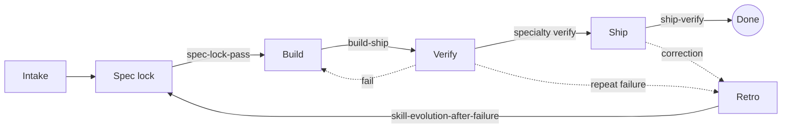

# moto-mode

**How I run an AI coding team: rules, gates, and verify loops, not prompts.**

[](https://github.com/smallkinepro/moto-mode/actions/workflows/ci.yml)


AI coding agents are fast and confidently wrong. A better prompt does not fix that. Structure does: each role has one job, every stage ends at a gate that needs evidence, and every failure turns into a written rule so it happens once. This repo is that structure, packaged so any agent (Cursor, Claude Code, Codex, or anything that reads `AGENTS.md` or Agent Skills) can use it.

## The workflow



Every arrow is a skill that must pass with evidence (command, commit SHA, output) before work moves on. Details in [`workflows/`](workflows/).

## What's inside

| Path | What it is |
|---|---|
| [`AGENTS.md`](AGENTS.md) | Entry point: team model, gates, where things live |
| [`rules/`](rules/) | Always-on rules: global, software, data/dbt, docs |
| [`workflows/`](workflows/) | Intake, spec lock, build, verify, ship, retro |
| [`guardrails/`](guardrails/) | Approval gates, secrets, destructive ops, public safety, cost limits |
| [`skills/`](skills/) | 16 [Agent Skills](https://agentskills.io) (SKILL.md), validated in CI |
| [`seats/`](seats/) | Role templates: chief of staff, designer/researcher, builder, data engineer, reviewer |

## Quick start (60 seconds)

**Cursor**
```bash
npx skills add smallkinepro/moto-mode          # installs skills/
git clone --depth 1 https://github.com/smallkinepro/moto-mode /tmp/moto-mode
mkdir -p .cursor/rules && cp /tmp/moto-mode/.cursor/rules/*.mdc .cursor/rules/
```
(The `.mdc` files are generated from `rules/` by `scripts/render_rules.py`.)

**Claude Code**
```text
/plugin marketplace add smallkinepro/moto-mode
```
or copy skills by hand: `cp -r skills/* ~/.claude/skills/`

**Codex and other AGENTS.md agents**
```bash
curl -fsSLO https://raw.githubusercontent.com/smallkinepro/moto-mode/main/AGENTS.md
npx skills add smallkinepro/moto-mode
```

Then ask your agent to "run ship-verify" before it tells you something is done.

## Skills

| Layer | Skills |
|---|---|
| Gates (every change) | `ship-verify`, `build-ship`, `spec-lock-pass`, `code-review-checklist` |
| Software | `design-qa`, `native-game-headless-verify`, `ticket-acceptance-criteria` |
| Data | `data-ingest-gate`, `pipeline-ship`, `report-publish-bar` |
| Team and meta | `oss-scout-gate`, `repo-brief`, `agent-design-bar`, `specialty-skill-tree`, `skill-evolution-after-failure`, `agent-skill-spec-check` |

## Design decisions

| Decision | Why | Tradeoff |
|---|---|---|
| Gates need evidence, not a "looks good" | Agents report success they didn't check; a SHA plus output can't be faked by tone | Slower handoffs; every stage costs a few extra commands |
| One job per role | Narrow roles are easier to verify and harder to drift | More handoffs; small tasks feel heavy (merge roles for solo work) |
| Builder never reviews its own work | Self-review repeats the same blind spots | Needs a second agent or human pass |
| Skills, not giant system prompts | Loaded on demand, portable across agents, lintable against a spec | Agents must be told to use them; discovery depends on good descriptions |
| Failures become skill edits | A lesson kept only in chat history is lost next session | Skill sprawl, so the rule is to edit the parent skill before adding one |
| Humans approve irreversible actions | Public, paid, and destructive steps can't be undone | The team waits on a person, so batch approvals into slices |
| Rules in plain Markdown, rendered per agent | One source of truth, no vendor lock-in | A render step to maintain |
| Denylist stored as a CI secret | The list of sensitive terms is sensitive itself | Contributors can't run the exact scan locally |

## Case studies

### Headless game CI that actually proves the game runs
A native game prototype had green unit tests but no proof it ran. The verify skill (`native-game-headless-verify`) now requires a scripted headless run whose JSON state output is diffed across two runs for determinism, an offscreen screenshot that a reviewer opens, and a remote-protocol smoke test. Pitfalls captured along the way:
- The linker crashed with a bus error on CI runners. Root cause: full debug info plus a full disk. Fix: `debug = "line-tables-only"` and freeing disk before the build.
- Warm CI went from about 11.5 minutes to about 3.5 by caching `~/.cargo/bin`, using one shared cache key saved only by the test job, and keeping only the pinned toolchain installed.
- A stuck software renderer hung jobs for the full default timeout, so every step now has its own `timeout-minutes`.

### A dbt-on-DuckDB pipeline gate
A small analytics pipeline on public data kept passing `dbt build` while serving stale or partial marts. The `pipeline-ship` gate adds grain tests on every model, row-count bands, a max-date freshness check, and a rule against unapproved schedules. When a new DuckDB major version shipped ahead of the hosted warehouse's client support, the rule "pin the engine, bump in its own PR" caught it before a broken refresh.

## License

[MIT](LICENSE). Use it, fork it, adapt it.

## About

Built by **David Shimamoto**. I use this stack to run my own team of AI coding agents across games, web, and data projects.
[LinkedIn](https://www.linkedin.com/in/davidshimamoto)
