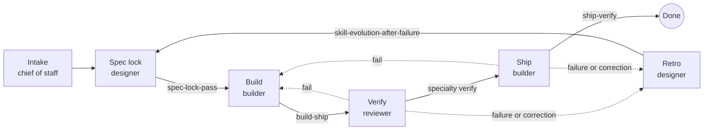

# workflows

Six stages, one owner each, one gate between each. A stage is not finished until its gate passes with evidence.

| Stage | Doc | Gate skill | Human approval? |
|---|---|---|---|
| Intake | [intake.md](intake.md) | ticket-acceptance-criteria | Priority and new projects |
| Spec lock | [spec-lock.md](spec-lock.md) | spec-lock-pass | Spec sign-off |
| Build | [build.md](build.md) | build-ship | No |
| Verify | [verify.md](verify.md) | specialty verify + code-review-checklist | No |
| Ship | [ship.md](ship.md) | ship-verify | Public, paid, or irreversible actions |
| Retro | [retro.md](retro.md) | skill-evolution-after-failure | No |
